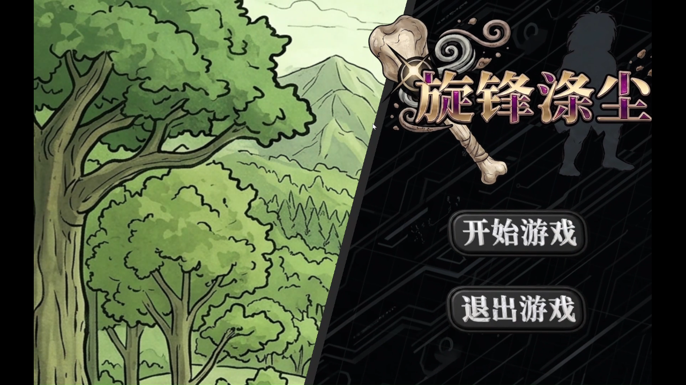
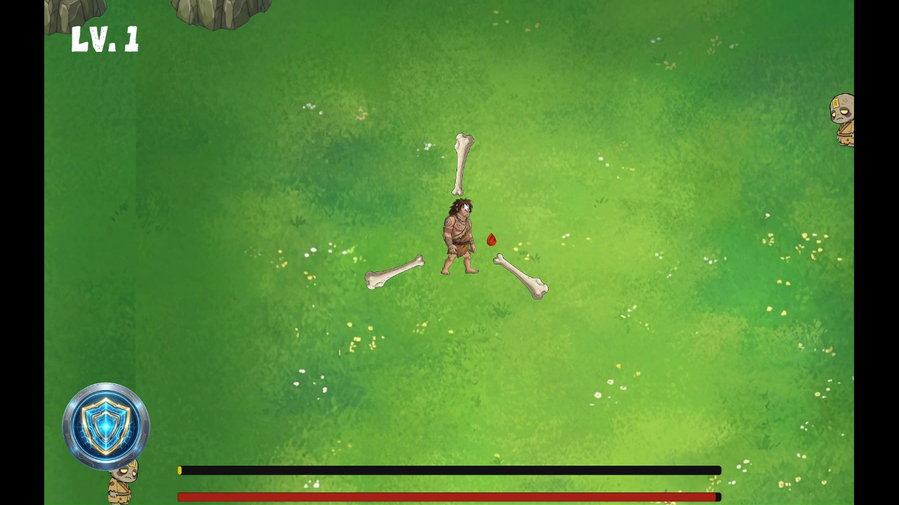
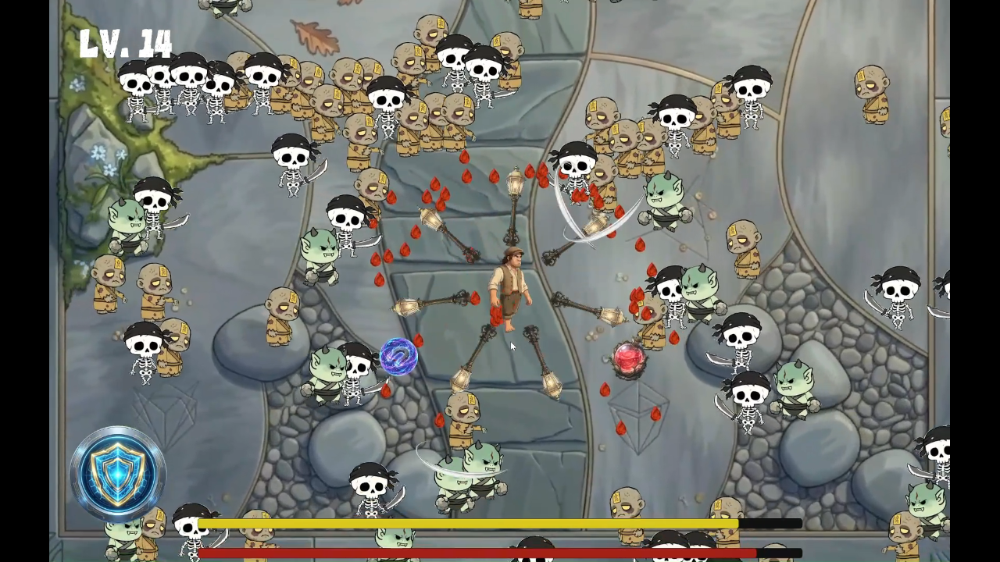

# 旋锋涤尘 · XUANFENG DICHEN

一款 2D 俯视角「弹幕割草」游戏，用 Unity 实现。单键移动，武器自动环绕角色旋转切割，怪潮从四面八方压上来。

## 玩什么

- **操作极简**：只控制移动，伤害由「骨刀环绕 + 数量 + 转速」自动产生，注意力全在走位上
- **三段式成长**：LV.1 疯狂原始人 → LV.20 铁血战士 → LV.50 未来机甲，外观、武器、特效同步跃迁
- **怪潮递进**：基础怪低血高密度负责「爽」，精英怪高血带盾负责「压力」，BOSS 多阶段负责「目标」
- **即时反馈**：刀光拖尾、受击震屏、升级全屏粒子，把「割草」的成就感做满

| LV.1 | LV.14 |
|---|---|
|  |  |

## 开发方式

- **引擎**：Unity
- **代码**：核心玩法与战斗循环由 Gemini 3.0 Pro 生成，我负责拆需求、写提示词、验逻辑、调手感
- **设计稿**：[design-doc.pdf](design-doc.pdf)（玩法、成长、敌人、场景、表现层完整方案）
- **实机演示**：4 分 37 秒，见 Release 附件

## 怎么跑

1. 到 [Releases](../../releases) 下载 `旋锋涤尘-游戏本体.zip`
2. 解压，双击运行其中的 exe（Windows）

## 设计上的取舍

这个项目想解决一个具体的痛点：短视频里刷到的割草广告，点进去往往「宣传与实物不符」。所以设计稿里专门有一页对照表，把假广告的「一触即溃、没有血条、只能左右移动」和本作的真实机制逐条对照——**怪物有血条和抗性、角色有深度进化、场景有策略交互**。

> 「我们不仅是在做一个游戏，更是在还原玩家对爽感的想象。」

## 截图

| | |
|---|---|
|  |  |
|  | |
